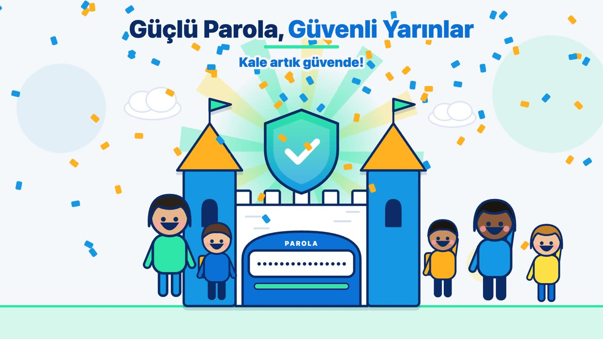

# 🛡️ Şifre Kalesi

Öğrenciler ve veliler için **şifre güvenliği testi**. Güvenli İnternet Haftası kampanyası kapsamında hazırlandı. Haftanın alışkanlığı: **güçlü parola**.

**Canlı site:** https://emircobanofficial.github.io/sifre-kalesi/

## Tanıtım videosu

30 saniyelik animasyon: görsele tıklayınca açılır. Videoyu sitede de izleyebilirsiniz: [Tanıtım videosu bölümü](https://emircobanofficial.github.io/sifre-kalesi/#video). Müzik ve ses efektleri bu proje için sıfırdan üretildi, telifsizdir.

## Neler var?

- **Anlık şifre analizi:** güç göstergesi, tahmini kırılma süresi, kontrol listesi ve kişiye özel öneriler
- **Zayıf ve güçlü şifre örnekleri:** "Test et" düğmesiyle ölçerde denenebilir
- **Altın kurallar** ve adım adım **cümle şifre** yöntemi
- **Doğru mu, yanlış mı?** çevrilen bilgi kartları
- **Veliler için** öneriler
- **Tanıtım videosu:** 30 saniyelik animasyon (fon müziği ve efektlerle)
- **Haftanın görevi:** 3 adımlı kontrol listesi (ilerleme cihazda saklanır)
- Mobil uyumlu, animasyonlu, ekran okuyucu ve klavye dostu

## Gizlilik

Yazılan şifre **hiçbir yere gönderilmez**. Analiz tamamen tarayıcıda yapılır. Sayfanın güvenlik politikası (`connect-src 'none'`) ağ isteği yapılmasını da engeller. Dış yazı tipi, takip kodu ya da reklam yoktur.

## Güç nasıl hesaplanıyor?

`sifre.js`, şifreyi parçalara ayırır: yaygın şifreler, kelime ve isimler, yıllar, sıralar (abc, 123, qwerty) ve tekrarlar. `@ → a` gibi değişiklikler de geri çözülür. Her parçanın tahmin edilme zorluğu toplanır. Süre, saniyede 10 milyar deneme yapan bir bilgisayar varsayımıyla hesaplanır.

## Yerelde çalıştırma

`index.html` dosyasını tarayıcıda açmak yeterli. Test: `node test.js`
